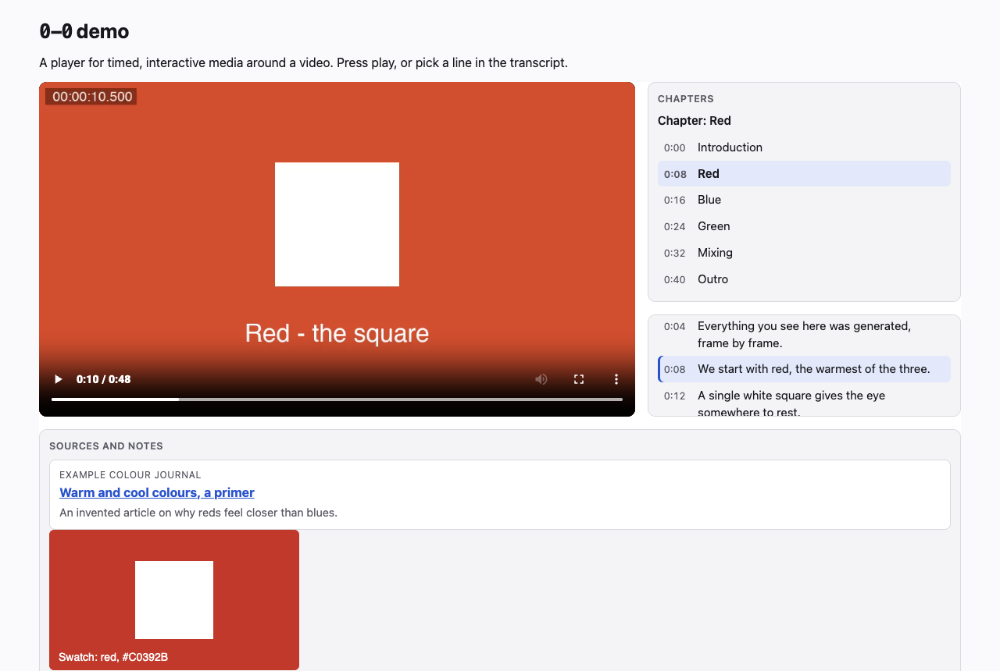
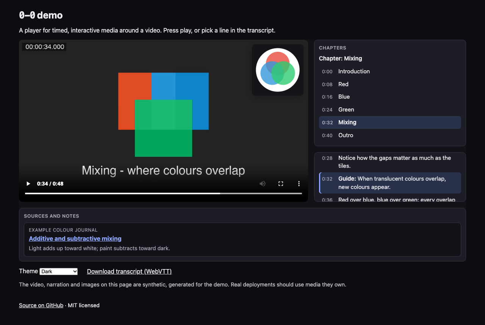

# 0-0

An open-source player for timed, interactive media around a video.

As a video plays, cues fire and elements appear in regions beside, below or over it: an interactive transcript with the current line highlighted (click any line to jump there), images, cards for the sources being referenced, and chapter markers. The name reads like a pair of glasses: one lens on the video, one on everything around it.

Status: **early development**. The cue format, engine and four element types work and are tested; the API may still change before 1.0.





## Who it is for

- **Publishers and journalists** who want readers to see the sources behind a video as they are mentioned.
- **Educators and course creators** who want lectures with a searchable, clickable transcript, diagrams and chapter navigation.
- **Documentary, podcast and video makers** who want to show notes, references and images in time with the story.

The first site built on it is [watchreplay.tv](https://watchreplay.tv).

## Quick start

The Web Component is the quickest way in:

```html
<script type="module" src="https://unpkg.com/0-0/dist/element.js"></script>

<zero-zero-player
  src="talk.mp4"
  cues="talk.cues.json"
  transcript="talk.captions.vtt"
></zero-zero-player>
```

- `src` is the media file. You can also put your own `<video>` or `<audio>` element inside the tag and 0-0 will use it.
- `cues` is a [cue document](docs/cue-format.md): regions plus timed cues, in JSON.
- `transcript` is an optional WebVTT captions file, turned into an interactive transcript.
- `theme` is `auto` (default), `light` or `dark`; `start` seeks to a time in seconds.

A minimal cue document:

```json
{
  "version": 1,
  "regions": [{ "id": "notes", "placement": "below", "label": "Sources" }],
  "cues": [
    {
      "id": "source-1", "start": 12, "end": 30, "type": "link", "region": "notes",
      "data": { "title": "The report mentioned here", "url": "https://example.com/report", "source": "Example News" }
    }
  ]
}
```

The package has not been published to npm yet; until it is, build it from source (below) and use `dist/element.js`.

### Programmatic API

```ts
import { createPlayer, loadCueDocument, createDefaultRegistry, transientPlugin } from '0-0';

const registry = createDefaultRegistry().register(
  transientPlugin<{ text: string }>('quote', (cue, ctx) => {
    const q = ctx.document.createElement('blockquote');
    q.textContent = cue.data.text;
    return q;
  }),
);

const player = createPlayer({
  container: document.querySelector('#player')!,
  src: 'talk.mp4',
  cues: await loadCueDocument('talk.cues.json'),
  registry,
});

player.on('cueenter', ({ cue }) => console.log('showing', cue.id));
```

The engine works without the player too: `new CueEngine(mediaElement, cues)` emits `cueenter` and `cueexit`, and `CueScheduler` does the same scheduling with no DOM at all.

## Features

- **Cue format**: versioned JSON with regions and typed cues, and a validator that reports every problem with its path (`cues[3].data.alt: is required`).
- **WebVTT**: captions and subtitles import as transcript cues (speakers from `<v>` tags); `metadata` tracks with JSON payloads import as typed cues; transcripts export back to WebVTT.
- **Engine**: an interval index finds active cues in O(log n + k); handles seeks, pauses and rate changes; uses `requestVideoFrameCallback` when available and `timeupdate` otherwise.
- **Elements**: transcript, image (alt text required), link card and chapters, through a registry you can extend.
- **Layouts**: sidebar, below and overlay regions; the sidebar stacks under the video when the player is narrow (a container query, so it follows the player's width, not the window's).
- **Accessibility**: native buttons and links, visible focus, polite live regions only where they help (chapter changes, opt-in regions), and `prefers-reduced-motion` respected.
- **Theming**: light and dark themes through `--zz-*` CSS custom properties, which pass through the shadow root.
- **No runtime dependencies.**

## Built with

TypeScript, Vite (library and demo builds), Vitest with jsdom, ESLint with typescript-eslint, and ffmpeg for the synthetic demo video.

## Development

```sh
npm ci
npm run dev       # demo at http://localhost:5173
npm test          # unit tests
npm run lint      # ESLint and tsc --noEmit
npm run build     # library (dist/) and demo site (dist-demo/)
npm run media     # regenerate the demo video (needs ffmpeg)
npm run screenshots
```

The demo accepts `?t=SECONDS` and `?theme=light|dark`, which is how the screenshots above are captured.

### About the demo media

Everything in the demo is synthetic: the video is flat colours, simple shapes and on-screen titles generated with ffmpeg (`scripts/generate-demo-media.sh`), the narration is invented, and the images are hand-written SVGs. Real deployments should use media they own or have the rights to.

## What's next

Estimates are rough working hours. The full plan is in [ROADMAP.md](ROADMAP.md).

1. **Visual cue editor with a timeline** (about 60 h): drag cues on a timeline over the video, edit their data in a form, and save a cue document.
2. **Media adapters for HLS, YouTube and Vimeo** (about 24 h): the engine already depends only on a small media interface.
3. **More element types** (about 24 h): quotes, footnotes, maps, code snippets and polls.
4. **Cue authoring from transcripts** (about 16 h): turn marked-up transcript lines into link, image and chapter cues.
5. **Multiple transcript languages** (about 14 h): a language switcher and per-language WebVTT files, plus translatable UI strings.
6. **Accessibility audit** (about 16 h): screen reader passes, keyboard shortcuts, and fixes from the findings.
7. **Performance with thousands of cues** (about 14 h): virtualised transcript rendering and benchmarks.
8. **Docs site at 0-0.in** (about 16 h): guides, API reference and live examples.

## Prior art

Mozilla's Popcorn.js and Popcorn Maker, which stopped development around 2015, showed how much a video gains when the web around it moves in time with it. 0-0 is a fresh implementation of that idea with current web platform features.

## Links

- Demo and docs: [0-0.in](https://0-0.in) (until then, [plutado.github.io/0-0](https://plutado.github.io/0-0/))
- Cue format: [docs/cue-format.md](docs/cue-format.md)
- System design: [docs/system-design.md](docs/system-design.md)
- Decisions: [docs/decisions/](docs/decisions/)
- Contributing: [CONTRIBUTING.md](CONTRIBUTING.md)
- Changelog: [CHANGELOG.md](CHANGELOG.md)

## License

[MIT](LICENSE). Copyright (c) 2026 David Fugate.
